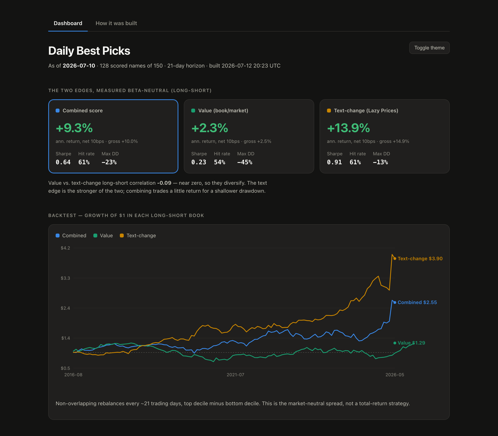

# Stock Predictor — cross-sectional factor research + daily picks dashboard

[](https://github.com/abhinav-devpura/Stock_Predictor/actions/workflows/tests.yml)
[](LICENSE)

A behavioral-finance quant-research pipeline that ranks stocks each day by a
**combined cross-sectional score**, built from two edges that survived a strict
event-study + beta-neutral long-short validation gate:

- **Value** — sector-neutral book-to-market (cheap stocks outperform).
- **Text-change ("Lazy Prices")** — year-over-year 10-K/10-Q section-level text
  similarity; firms that materially rewrite their disclosures subsequently
  underperform, so *stable* filings score higher.

Every factor family we tested is measured as a **beta-neutral long-short** (top
decile minus bottom decile, rebalanced every ~21 trading days, net of costs), so
the reported edge is alpha rather than market beta.

> ⚠️ Research prototype for educational use — **not investment advice.**



**Live dashboard:** https://abhinav-devpura.github.io/Stock_Predictor/

## The dashboard

Two front ends, both reading a single pre-computed snapshot
(`frontend/picks.json`) so they render instantly with no data refetch:

| | What | Run |
|---|---|---|
| **Interactive app** | Streamlit — ranked picks with sector/factor filters, per-factor breakdown, backtest curves | `streamlit run app.py` |
| **Standalone page** | Self-contained HTML, opens with no server | open `frontend/dashboard.html` |

The committed `frontend/picks.json` and `frontend/dashboard.html` mean a fresh
clone shows the dashboard **immediately** — no hours-long first-run fetch.

**Publishing it (GitHub Pages):** `scripts/build_dashboard.py` also writes
`docs/index.html`. In the repo's **Settings → Pages**, set *Deploy from a branch*
→ `main` → `/docs`. Your dashboard goes live at the Live URL above — a *project
site*, independent of any `username.github.io` personal site you may already have.
Re-run the build and commit `docs/` to refresh it.

## Results

Two factors cleared the validation gate; five families were rejected. Each edge
is a beta-neutral long-short (top decile minus bottom decile), net of 10 bps.

| Edge | Signal | Gate | Beta-neutral LS | Sharpe | Survivorship bias |
|---|---|---|---|---|---|
| **Value** | sector-neutral book/market | strict PASS | **+8.9%/yr** | 0.75 | *inflates* it → read with caution |
| **Text-change** | section-level 10-K/10-Q similarity | PASS | **+13.9%/yr** | 0.85 | *understates* it → conservative |

The two are essentially uncorrelated (−0.13), and both *strengthen* out of sample
rather than fading. The rejected families — with the reason each failed — are the
other half of the story:

| Rejected | Idea | Why it failed |
|---|---|---|
| Calendar effects | turn-of-month / January seasonality | unstable or wrong-signed |
| Momentum (12–1) | winners keep winning | ≈0, flips across the regime split |
| PEAD | post-earnings drift | early pass, faded late; vanishes as a long-short |
| Short-term reversal | 5-day losers bounce | huge early (*t*=7.4), gone late |
| Insider buying (Form 4) | insiders buy before good news | early-strong / late-fade |

The full phase-by-phase log is in [NOTES.md](NOTES.md); the illustrated version
is the **[How it was built](https://abhinav-devpura.github.io/Stock_Predictor/process.html)** page.

## Methodology & limitations

**How a factor earns its place.** Every candidate must clear the same event-study
gate before it's used: rank the universe, compare the top vs. bottom bucket's
forward returns (Welch *t*-test), and require significance in **both halves** of
the sample with the sign fixed *a priori* — then confirm a positive
**beta-neutral long-short** (which strips out market beta, the trap that made an
early top-decile portfolio look like alpha when it wasn't). The gate harness is
self-tested on synthetic data.

**Leakage discipline.** Fundamentals and filings are aligned point-in-time — a
value is usable only on the next trading day strictly *after* its SEC filing
date — and validation samples non-overlapping forward windows with an embargo,
so no future information reaches a signal. These invariants are enforced by unit
tests (`tests/test_leakage.py`).

**Limitations (read these).**
- **Survivorship bias.** The universe is today's index members, so bankrupt names
  are absent. This *inflates* the value edge (its true premium is likely well
  below +8.9%) and *understates* text-change. Magnitudes should be read with
  skepticism; the qualitative behavior is the robust finding.
- **Small universe / period.** ~150–565 names since 2016 — not a full
  cross-section, and one macro regime (the 2021+ shift) dominates the split.
- **Costs & capacity.** Backtests charge 10 bps and ignore market impact, borrow
  cost on the short leg, and capacity limits. This is research, not a live P&L.

## Quick start

```bash
python -m venv venv && source venv/bin/activate      # Windows: venv\Scripts\activate
pip install -r requirements.txt
cp .env.example .env                                  # then set EDGAR_USER_AGENT

streamlit run app.py                                  # open the dashboard
```

To rebuild the snapshot from your own freshly-fetched data:

```bash
python scripts/build_picks.py                   # recompute from cache (fast, same as last time)
python scripts/build_picks.py --refresh         # + refetch prices (new as-of date, updated book/market)
python scripts/build_picks.py --refresh-edgar   # + refetch SEC filings/fundamentals (slow; picks up new 10-K/10-Q)
python scripts/build_dashboard.py               # regenerate the HTML pages + docs/
```

Everything is cached under fixed keys, so a plain `build_picks.py` reproduces the
last snapshot — use `--refresh` / `--refresh-edgar` to actually pull new data.

## Keeping it fresh automatically

`.github/workflows/refresh-picks.yml` runs on the **1st of each month** (or on
demand from the **Actions** tab) and refreshes **both** signals, then commits so
Pages redeploys:

- **Prices** (`--refresh`) — updates market cap / book-to-market and the as-of date.
- **EDGAR, incremental** (`--refresh-edgar`) — fetches only the 10-K/10-Q and
  fundamentals **filed since the committed cache**. The expensive-to-compute
  features are committed to the repo, so a run downloads only what's genuinely new
  (usually little or nothing) and finishes in minutes — no full multi-hour SEC
  re-pull. Updated caches are committed back, so each run builds on the last.

This means the **stronger text-change signal stays current too**, not just the
price-driven value signal — new filings show up at the next monthly run.

**One-time setup:** add your SEC user-agent as a repository secret —
**Settings → Secrets and variables → Actions → New repository secret**, name
`EDGAR_USER_AGENT`, value like `your-name research you@example.com` (the
incremental fetch hits SEC EDGAR, so this is required). *(GitHub pauses scheduled
workflows after 60 days of repo inactivity — a push or manual run re-arms them.)*

## First-run data note

The `data_cache/` directory (EDGAR fundamentals, filing text, price panels) is
**git-ignored** — it's large and derived. The dashboard doesn't need it because
`picks.json` is committed. But if you rerun `scripts/build_picks.py` on a clean
clone, it will re-download prices (yfinance) and re-fetch SEC EDGAR filings,
which takes a while (SEC is rate-limited to <10 req/s) and requires
`EDGAR_USER_AGENT` set in `.env`. Runs are cached, so subsequent builds are fast.

## Layout

```
app.py                     Streamlit dashboard (reads frontend/picks.json)
config.py                  universe, horizon, EDGAR user-agent (env-configurable)
data/                      prices, EDGAR (fundamentals / filings / insider), universe, sectors
factors/                   value, quality, disclosure, momentum, reversal, calendar, pead
model/                     score (cross-sectional z-score) + backtest (beta-neutral long-short)
validation/                event_study gate (bucket_test, stability, passes_gate) + self_test
scripts/build_picks.py     compute the snapshot -> frontend/picks.json
scripts/build_dashboard.py render the snapshot -> frontend/dashboard.html
scripts/run_*.py           per-phase research runners (see NOTES.md)
frontend/picks.json        committed snapshot the front ends read
```

Run the validation harness any time with `python -m validation.self_test`.
